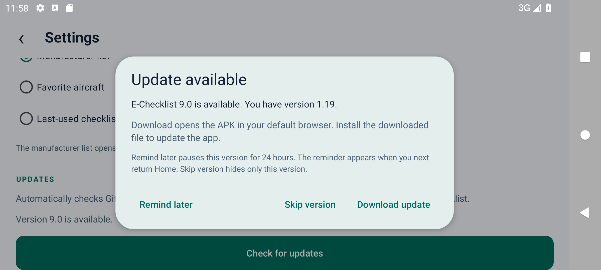
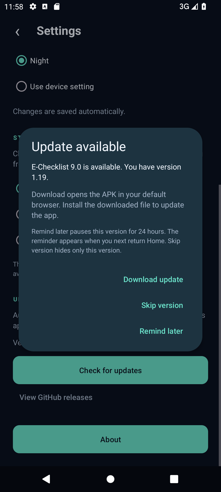

# GitHub update feature test report

Date: 26 October 2026 (Europe/Paris)

Build: E-Checklist 1.19, Android version code 21

Baseline: `b3c088f` plus the update feature in this working tree

## Results

- JVM unit tests: **20/20 passed**, no failures, errors or skipped cases.
- Debug, instrumentation and optimized Release APK builds: passed.
- Debug and Release lint: **0 errors**, 7 existing warnings each (six dependency-version suggestions and one range-typography suggestion).
- Android device tests: **46/46 passed** in 316 seconds, no failures, errors or skipped cases, including the live GitHub integration check.
- Signed release upgrade smoke check: **passed**. Android accepted installation over v1.18, retained the app UID, reported version 1.19, and launched the app without a fatal exception. The emulator's debug test app was removed before installing the signed releases.

## Behavior covered

| Cases | Verification |
| --- | --- |
| AppVersionTest: 6 JVM cases | Numeric ordering (`1.10 > 1.9`), major/four-part versions, `v` prefix, whitespace, build metadata, trailing-zero equivalence, canonical skip keys, oversized numbers, invalid and prerelease version rejection. |
| UpdateRulesTest: 6 JVM cases | Daily successful-check interval, hourly error retry, first use, device clock rollback, version-specific skipping, exact 24-hour reminder boundary, later versions remaining eligible. |
| ChecklistProgressTest: 8 JVM cases | Existing progress and checklist completion rules. |
| GitHubReleaseClientTest: 9 Android cases | Existing `Main` tag with versioned APK, numeric tags with generic APKs, highest numeric asset selection, drafts/prereleases, missing/debug/empty/incomplete assets, trusted repository HTTPS URLs, HTTP headers/timeouts, 404/403/429 results, server/malformed/oversized errors, connection cleanup, and persisted update choices independent of progress reset. |
| UpdateUiTest: 11 Android cases | Home prompt, skip surviving restart and reset, later release eligibility, 24-hour reminder surviving restart, deferred prompts while checking items, retained ticks, manual override of skip/reminder/daily interval, older release and error messages, disabled button while checking, activity recreation during requests and dialogs, automatic prompt restoration without recording a choice, Back deferral, external browser intent, hourly offline retry, and day/landscape plus night/portrait action visibility. |
| GitHubReleaseLiveTest: 1 Android integration case | Real HTTPS request using the production client and manifest permission; stable published release must contain a recognized version and valid APK URL. Enabled explicitly with `-e liveGithub true`; skipped in ordinary offline test runs. |
| SettingsTest: 4 regression cases | Font sizes, day/night/system appearance, persistence, reader appearance, informational headings, and About details. |
| AircraftNavigationTest: 8 regression cases | Favorites, recent aircraft, startup choices, fallback behavior, navigation restoration and progress preservation. |
| ToolbarTitleTest: 4 regression cases | Model titles for all aircraft, settings/reader/rotation/recreation, shortcuts, and narrow-phone controls. |
| NavigationLifecycleTest: 1 regression case | Root Back/background/foreground handling. |
| ChecklistAppTest: 8 regression cases | Bundled catalog validation, source reader/return, checklist completion/advancement, final-phase behavior, automatic scrolling, rotation, reset cancellation/confirmation, restart and phase-scoped progress. |

## Environment and method

- Android 12 / API 31, x86_64, `Medium_Phone_API_31`, 1080 × 2400 px at 420 dpi; narrow-phone regression also uses 320dp width.
- Disposable emulator launched with `-read-only -no-snapshot-save -no-window`. Every ADB command explicitly targets `emulator-5554`; the connected physical phone is untouched.
- Animation scales are zero for deterministic Espresso replay. Day and Night prompts are checked, including landscape scrolling and all three actions.
- Release parsing, errors, delays, future versions and time passage use controlled fixtures and a test clock; no fake future release is published to GitHub. The browser handoff test intercepts the external HTTPS intent without downloading/installing another APK.
- Live GitHub integration runs separately from the injected future-version responses. The actual latest public release at test time uses tag `Main` and APK filename `E-Checklist-v1.17-release.apk`; this is older than 1.19 and must not trigger an update prompt.
- The initial 18-case run passed 16 cases; explicit dialog-root matching corrected one test synchronization issue. A subsequent 45-case run passed 44 and exposed a Settings prompt restoration bug: a retiring dialog window could retain focus after activity recreation. The app now removes prompt windows when pausing, saves whether a prompt was visible, and restores that prompt after resuming without waiting for the retiring window's focus. Pending checks remain shared and no user skip/reminder choice is recorded during recreation. The isolated failing case then passed, and the final run adds an automatic Home prompt restoration regression.

Commands:

```powershell
.\gradlew.bat --no-configuration-cache testDebugUnitTest assembleDebug assembleDebugAndroidTest assembleRelease lintDebug lintRelease
adb -s emulator-5554 install -r app/build/outputs/apk/debug/app-debug.apk
adb -s emulator-5554 install -r app/build/outputs/apk/androidTest/debug/app-debug-androidTest.apk
adb -s emulator-5554 shell am instrument -w -r -e liveGithub true -e class com.jerry.electrical_checklist.GitHubReleaseClientTest,com.jerry.electrical_checklist.UpdateUiTest,com.jerry.electrical_checklist.GitHubReleaseLiveTest,com.jerry.electrical_checklist.SettingsTest,com.jerry.electrical_checklist.AircraftNavigationTest,com.jerry.electrical_checklist.ToolbarTitleTest,com.jerry.electrical_checklist.NavigationLifecycleTest,com.jerry.electrical_checklist.ChecklistAppTest com.jerry.electrical_checklist.test/androidx.test.runner.AndroidJUnitRunner
```

## Release artifact

Signed APK: [`E-Checklist-v1.19-release.apk`](../output/E-Checklist-v1.19-release.apk)

- SHA-256: `027e301ecd670a39d028555738077f7fcf247cdbe3600d6d448d1b4b3015de4d`
- Existing release signing certificate SHA-256: `85cddbb180d91649c82d4c178394d91008fc3e2933fffc5b6ea3986fc746e993`.
- APK signature verification and ZIP alignment passed. The private signing key remains outside version control.
- The signed-release upgrade commands and results are recorded in [`release-upgrade-smoke.json`](../output/testing/2026-10-26/updates/release-upgrade-smoke.json). This checks installation and startup; the checklist progress regression cases use the debug build.

## Scope and limits

This records tested behavior, not a guarantee of no bugs on every device. Android API 31 is the runtime environment tested here. No background notification, automatic APK download, or automatic installation is implemented. Reminders appear during later foreground app use on Home, with release information available. Future releases must be published with a supported signed APK; a Git push alone does not announce an update. Download-manager behavior and end-user installation permissions are managed by the user's browser and Android.

The earlier [full v1.18 report](TEST-REPORT-2026-10-26.md) records the broader aircraft/document suite; checklist source data was unchanged for this feature.

## Visual checks

Both screenshots show an injected future version (`9.0`), not a published release. Text and all three actions remain visible; portrait uses stacked native dialog buttons, and landscape places them in a row. Dialog content can scroll on shorter displays.





Build, signing, lint and JVM test evidence is stored in [`output/testing/2026-10-26/updates`](../output/testing/2026-10-26/updates).
